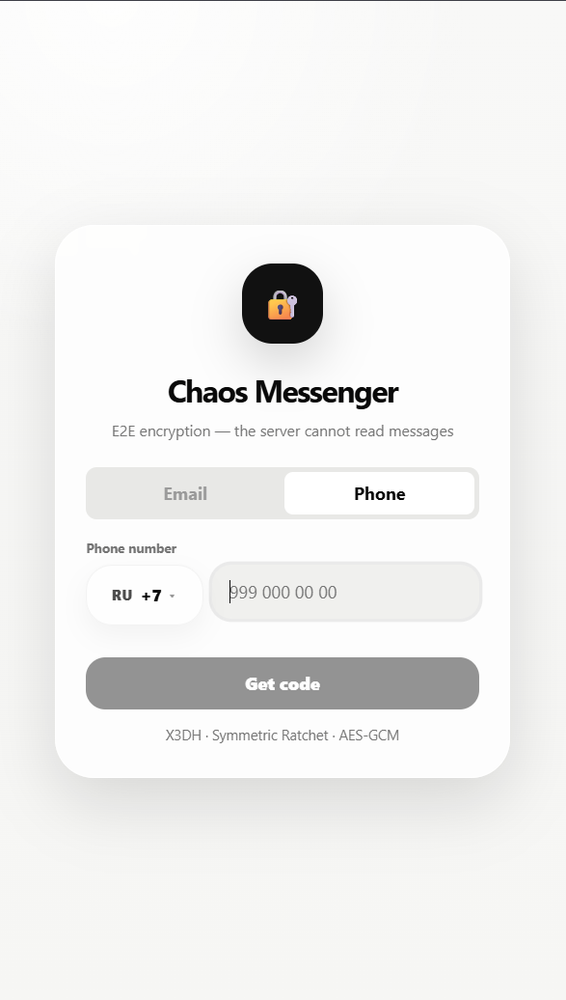
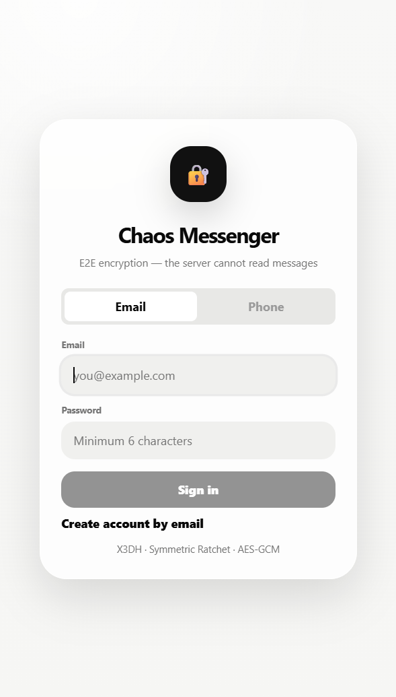
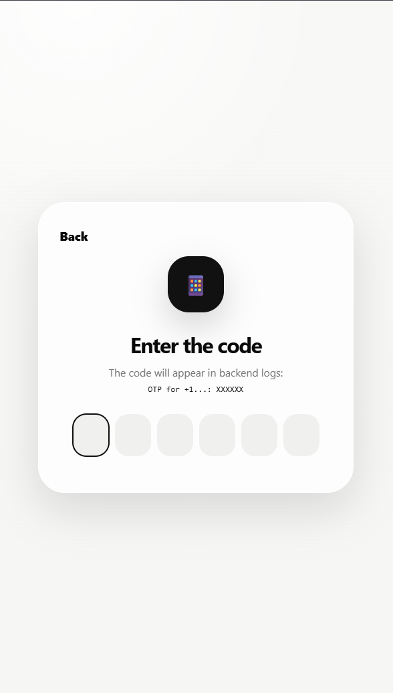
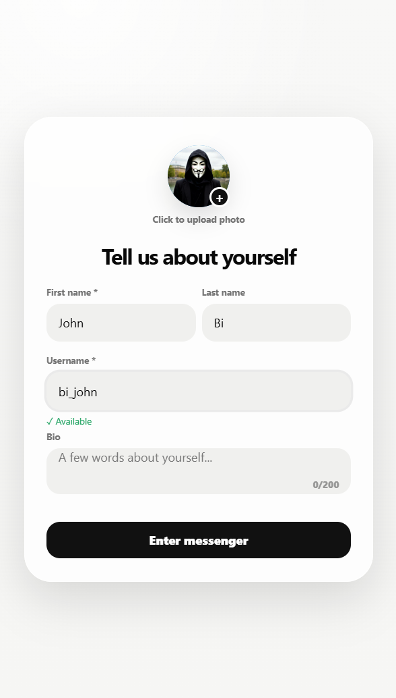
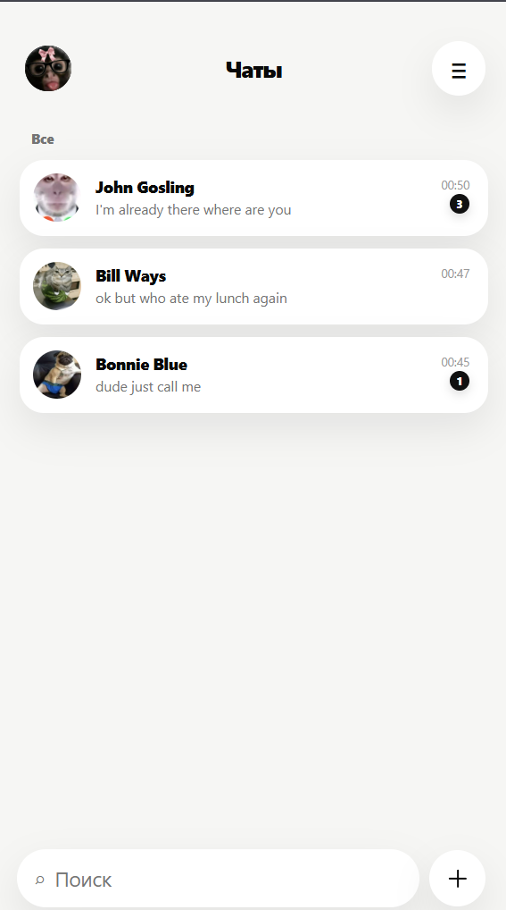
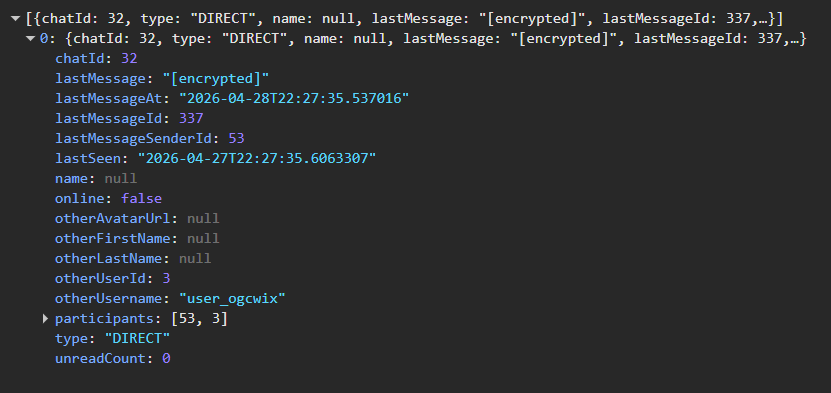
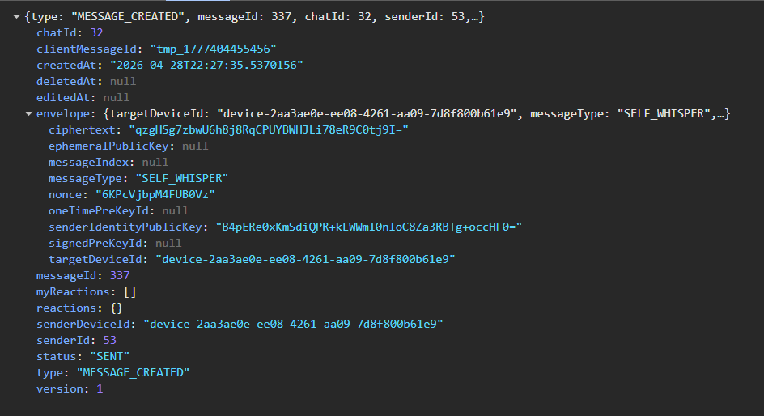

<div align="center">

```
░█████╗░██╗░░██╗░█████╗░░█████╗░░██████╗
██╔══██╗██║░░██║██╔══██╗██╔══██╗██╔════╝
██║░░╚═╝███████║███████║██║░░██║╚█████╗░
██║░░██╗██╔══██║██╔══██║██║░░██║░╚═══██╗
╚█████╔╝██║░░██║██║░░██║╚█████╔╝██████╔╝
░╚════╝░╚═╝░░╚═╝╚═╝░░╚═╝░╚════╝░╚═════╝░
```

### Realtime E2EE messenger — the server cannot read your messages

*Spring Boot 3 · React 18 · WebSocket/STOMP · X3DH · Symmetric Ratchet · AES-GCM · WebCrypto*


<br/>

[](https://github.com/Hrushikesh-ramilla/HashChat/actions/workflows/ci.yml)
[](https://openjdk.org/)
[](https://spring.io/projects/spring-boot)
[](https://react.dev/)
[](https://www.postgresql.org/)
[](https://redis.io/)
[](https://stomp.github.io/)
[](http://localhost:8080/swagger-ui/index.html)

<br/>

[Overview](#overview) · [How E2EE works](#how-e2ee-works) · [Features](#features) · [Architecture](#architecture) · [Screenshots](#screenshots) · [Quick Start](#quick-start) · [API](#api) · [Monitoring](#monitoring) · [Roadmap](#roadmap)

</div>

---

## Overview

**HashChat** is a full-stack realtime messenger built around one core idea: **the server never sees your messages**.

Every message is encrypted on the sender's device before it leaves the browser. The backend stores and routes opaque encrypted blobs — it has no keys, no plaintext, no ability to read what you wrote. This is verifiable: open DevTools, send a message, watch the network tab.

<p align="center">
  
</p>

<p align="center">
  <sub>🔒 Messages are encrypted on this device</sub>
</p>

The project covers the full stack end-to-end: auth, device management, key exchange, realtime delivery, observability, and a clean React UI — all wired together and tested.

---

## How E2EE works

Most apps that claim E2EE still let their servers read metadata or temporarily hold plaintext. Here is what HashChat actually does — and you can verify every step in your browser.

### Key exchange — X3DH

When you first message someone, your devices perform an [X3DH (Extended Triple Diffie-Hellman)](https://signal.org/docs/specifications/x3dh/) handshake using prekeys published to the server. This derives a shared secret without either side ever transmitting it. The server only sees public keys — never the derived secret.

### Per-message encryption — Symmetric Ratchet + AES-GCM

After the session is established, every message gets a unique key via a **symmetric ratchet**:

```
nextChainKey = HMAC-SHA256(chainKey, 0x02)
messageKey   = HMAC-SHA256(chainKey, 0x01)
```

Each message is encrypted with `messageKey` using AES-GCM. Old message keys are never stored — forward secrecy per message.

### What the server actually receives

```json
{
  "envelope": {
    "ciphertext": "qzgHSg7zbwU6h8j8RqCPUYBWHJLi78eR9C0tj9I=",
    "nonce": "6KPcVjbpM4FUB0Vz",
    "senderIdentityPublicKey": "B4pERe0xKmSdiQPR+kLWWmI0nloC8Za3RBTg+occHF0=",
    "targetDeviceId": "device-2aa3ae0e-ee08-4261-aa09-7d8f800b61e9",
    "messageType": "SELF_WHISPER"
  }
}
```

And what the server returns when you query the chat list:

```json
{
  "lastMessage": "[encrypted]"
}
```

Not `***`. Not `[redacted]`. Literally `[encrypted]` — because the server has no other value to return.

> **Scope note.** This implementation uses a *symmetric* ratchet, not the full Double Ratchet (Signal Protocol). There is no Diffie-Hellman ratchet step, so break-in recovery is not implemented. Forward secrecy is per-message within a session. This is clearly labelled in the codebase and security audit.

---

## Features

<table>
<tr>
<td width="50%">

### Security & Encryption

- Client-side E2EE — backend never holds plaintext
- X3DH session bootstrap via prekeys
- Signed prekey verification
- Symmetric ratchet — unique key per message
- AES-GCM encryption via WebCrypto API
- Device identity stored in browser only
- Multi-device envelope fanout
- JWT authentication (access + refresh tokens)
- Redis rate limiting on SMS codes
- Hardened WebSocket authorization
- Explicit CORS origins + security headers

</td>
<td width="50%">

### Messaging

- Direct (1:1) chats
- Group chats
- Realtime delivery via WebSocket/STOMP
- Typing indicator
- Delivery and read receipts (✓✓)
- Reply to message
- Edit message
- Soft delete
- Photo attachments
- Online presence
- Message search

</td>
</tr>
<tr>
<td width="50%">

### Backend

- Spring Boot 3 + Spring Security
- PostgreSQL 16 + Flyway (22 migrations)
- Redis 7 — tokens, presence, rate limits
- OpenAPI 3.1 / Swagger UI
- Spring Boot Actuator
- Prometheus metrics endpoint
- Grafana dashboard provisioning
- Docker Compose (dev + prod profiles)
- GitHub Actions CI

</td>
<td width="50%">

### Frontend

- React 18 + Vite
- Zero crypto dependencies — pure WebCrypto API
- Crypto engine as standalone ES module
- Device identity managed client-side
- STOMP/WebSocket client
- Phone + email authentication
- i18n support (EN / RU)
- Unit tests (Vitest) + E2E (Playwright)

</td>
</tr>
</table>

---

## Architecture

```
Browser (React + WebCrypto)
  ├── REST — auth, profile, chats, messages, devices, prekeys
  ├── WebSocket/STOMP — realtime events per device
  └── crypto-engine.js — X3DH · Ratchet · AES-GCM · key storage

Spring Boot Backend
  ├── Auth — phone OTP / email, JWT, refresh tokens
  ├── Device registry — prekey bundles, signed prekeys
  ├── Message fanout — one encrypted envelope per recipient device
  ├── WebSocket — per-device STOMP topics, JWT auth
  ├── Redis — refresh tokens, online presence, SMS rate limits
  └── PostgreSQL — users, devices, chats, encrypted envelopes

Observability
  ├── Actuator — health, info, metrics
  ├── Prometheus — scrapes /actuator/prometheus
  └── Grafana — provisioned dashboard
```

<p align="center">
  
</p>

**The core principle:** client and server have strictly separated responsibilities.

| Layer | Responsibility |
|---|---|
| Browser | Create keys · Encrypt · Decrypt · Store identity |
| Backend | Authenticate · Route · Store envelopes · Deliver |
| Database | Persist state and encrypted payloads |
| Redis | Fast ephemeral state — tokens, presence, rate limits |

---

## Screenshots

<table>
<tr>
<td align="center" width="33%">
  <br/>
  <sub>Phone authentication</sub>
</td>
<td align="center" width="33%">
  <br/>
  <sub>Email authentication</sub>
</td>
<td align="center" width="33%">
  <br/>
  <sub>SMS code verification</sub>
</td>
</tr>
<tr>
<td align="center">
  <br/>
  <sub>Profile setup</sub>
</td>
<td align="center">
  <br/>
  <sub>Chat list with unread badges</sub>
</td>
<td align="center">
  <br/>
  <sub>Create direct or group chat</sub>
</td>
</tr>
<tr>
<td align="center">
  <br/>
  <sub>Live conversation with read receipts</sub>
</td>
<td align="center">
  <br/>
  <sub>Active devices — multi-device E2EE</sub>
</td>
<td align="center">
  <br/>
  <sub>OpenAPI — full API docs</sub>
</td>
</tr>
</table>

<details>
<summary>🔐 Under the hood — DevTools proof</summary>

<br/>

**Chat list API — server returns `[encrypted]`, not message text:**



<br/>

**WebSocket event — server delivers a ciphertext envelope, not plaintext:**



</details>

---

## Quick Start


**Or just use the start script:**

```bash
# macOS / Linux
./START.sh

# Windows
START.bat
```

### Manual setup

**Requirements**

```bash
java -version       # 17+
mvn -version        # 3.8+
node --version      # 18+
docker --version
docker compose version
```

**1. Start infrastructure**

```bash
cd backend
docker compose -f docker-compose.dev.yml up -d
```

**2. Start backend**

```bash
cd backend
mvn spring-boot:run
```

**3. Start frontend**

```bash
cd frontend
npm install
npm run dev
```

**4. Open the app**

```
http://localhost:5173
```

> In dev mode, SMS verification codes appear in backend logs — no SMS provider needed.

---

## Local URLs

| Service | URL |
|---|---|
| Web Client | http://localhost:5173 |
| Backend API | http://localhost:8080 |
| Swagger UI | http://localhost:8080/swagger-ui/index.html |
| OpenAPI JSON | http://localhost:8080/api-docs |
| Actuator Health | http://localhost:8080/actuator/health |
| Prometheus Metrics | http://localhost:8080/actuator/prometheus |
| Prometheus UI | http://localhost:9090 |
| Grafana | http://localhost:3000 (admin / admin) |

---

## API

The API is documented via OpenAPI 3.1. Start the backend and open Swagger UI at `http://localhost:8080/swagger-ui/index.html`.

Every protected endpoint requires:
- `Authorization: Bearer <jwt>` — access token
- `X-Device-Id: <uuid>` — registered device UUID

### Endpoint groups

| Group | Description |
|---|---|
| **Auth** | Phone OTP flow, email login, JWT refresh, logout |
| **Profile** | Username, display name, avatar, bio |
| **Devices** | Register device, upload prekeys, signed prekey rotation |
| **Crypto** | Fetch prekey bundles for session establishment |
| **Chats** | Create direct / group chat, list chats |
| **Messages** | Send · edit · delete · status updates |
| **Users** | Search by username, user info |

### WebSocket topics

| Topic | Purpose |
|---|---|
| `/topic/devices/{deviceId}` | Per-device encrypted message delivery |
| `/topic/users/{username}/chats` | Chat list updates |
| `/topic/chats/{chatId}/typing` | Typing events |
| `/topic/user/status` | Presence updates |

---

## Monitoring

```bash
cd backend
docker compose up -d prometheus grafana
```

Grafana opens at `http://localhost:3000` (admin / admin). The dashboard is pre-provisioned — no manual setup needed.

Prometheus scrapes metrics from `http://localhost:8080/actuator/prometheus`.

Dashboard config files:

```
backend/src/main/resources/grafana-datasource.yml
backend/src/main/resources/grafana-dashboards.yml
backend/src/main/resources/hashchat-dashboard.json
```

---

## Project Structure

```
.
├── .github/workflows/           # GitHub Actions CI
├── backend/
│   ├── src/main/java/
│   │   └── com/hashchat/messenger/
│   │       ├── auth/            # Phone OTP + email auth, JWT
│   │       ├── chat/            # Chats, messages, service layer
│   │       ├── crypto/          # Devices, prekeys, envelope fanout
│   │       ├── infra/           # WebSocket, security config, filters
│   │       ├── user/            # Users, profiles
│   │       └── common/          # Error handling, i18n, utils
│   ├── src/main/resources/
│   │   ├── db/migration/        # 22 Flyway migrations
│   │   └── i18n/                # EN + RU error messages
│   ├── docker-compose.dev.yml   # PostgreSQL + Redis for dev
│   └── docker-compose.yml       # Full stack incl. monitoring
├── frontend/
│   ├── src/
│   │   ├── crypto-engine.js     # X3DH + Ratchet + AES-GCM
│   │   ├── components/          # AuthScreen, ChatList, MessageInput...
│   │   ├── hooks/               # useAuth, useChats, useMessages, useWebSocket
│   │   └── i18n/                # UI translations
│   ├── e2e/                     # Playwright E2E tests
│   └── src/test/                # Vitest unit tests
├── docs/assets/                 # Architecture SVG + screenshots
├── SECURITY_AUDIT_EN.md
```

---

## Tests

**Backend** — JUnit 5 + Testcontainers (real PostgreSQL + Redis in Docker):

```bash
cd backend
mvn test
```

**Frontend** — Vitest unit tests:

```bash
cd frontend
npm test
```

**E2E** — Playwright (requires running app):

```bash
cd frontend
npm run test:e2e
```

CI runs backend tests + frontend tests + frontend build on every push and pull request.

---

## Environment Variables

**Backend** (`backend/src/main/resources/application.properties` or env):

```env
JWT_SECRET=change-this-to-a-strong-32-plus-character-secret
JWT_EXPIRATION=86400000
HASHCHAT_CORS_ALLOWED_ORIGINS=http://localhost:5173
SPRING_DATASOURCE_URL=jdbc:postgresql://localhost:5432/hashchat
SPRING_DATASOURCE_USERNAME=postgres
SPRING_DATASOURCE_PASSWORD=postgres
SPRING_DATA_REDIS_HOST=localhost
SPRING_DATA_REDIS_PORT=6379
```

**Frontend** (`.env`):

```env
VITE_BACKEND_URL=http://localhost:8080
VITE_API_BASE=http://localhost:8080/api
VITE_WS_URL=http://localhost:8080/ws
```

---

## Roadmap

The current build is a solid MVP. Here is what comes next:

| Priority | Feature |
|---|---|
| 🔜 Near-term | Full Double Ratchet (DH ratchet step) |
| 🔜 Near-term | Android client with Android Keystore |
| 🔜 Near-term | Push notifications |
| 📅 Planned | Encrypted voice messages |
| 📅 Planned | Encrypted media storage |
| 📅 Planned | WebRTC audio/video calls + TURN/STUN |
| 📅 Planned | Staging and production deployment profiles |
| 💡 Ideas | Self-destructing messages |
| 💡 Ideas | Message reactions |
| 💡 Ideas | Desktop client (Electron or Tauri) |

---

## Contributing

Issues and pull requests are welcome. If you're writing about this project — mention the repo, it helps.

Areas that would benefit from contributions:

- Full Double Ratchet implementation
- Android client
- Additional test coverage
- Performance benchmarks under load

---

<div align="center">

Built with Java, React, and a healthy distrust of servers that claim to protect your data.

</div>
