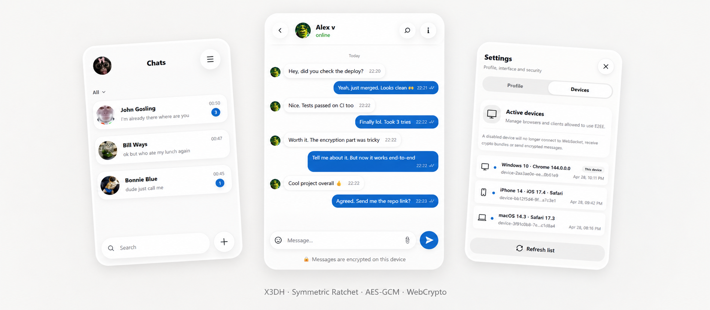
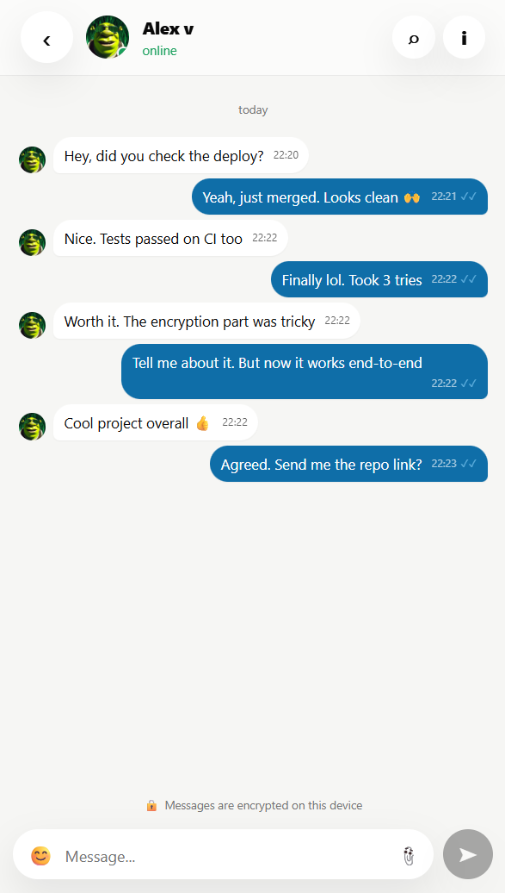
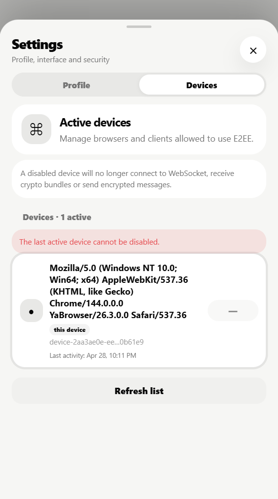
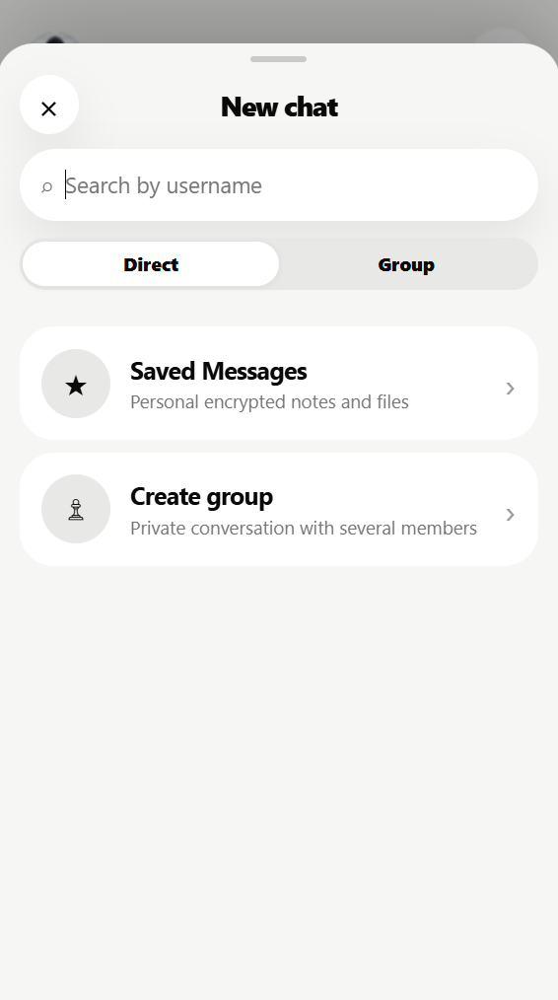
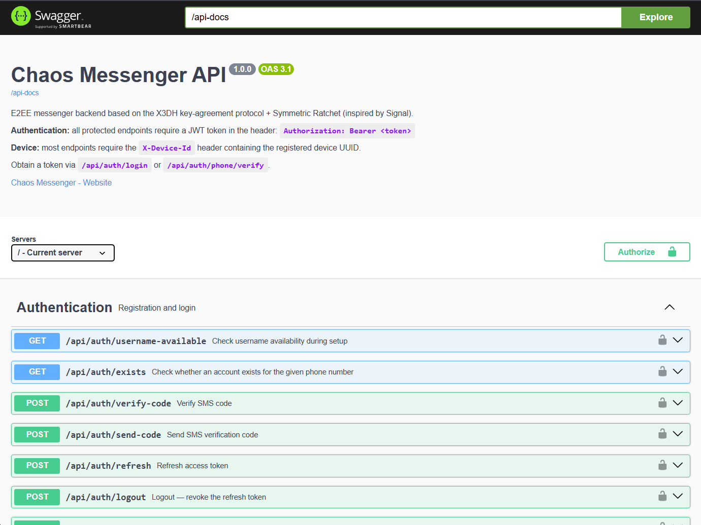

<div align="center">

```
░█████╗░██╗░░██╗░█████╗░░█████╗░░██████╗
██╔══██╗██║░░██║██╔══██╗██╔══██╗██╔════╝
██║░░╚═╝███████║███████║██║░░██║╚█████╗░
██║░░██╗██╔══██║██╔══██║██║░░██║░╚═══██╗
╚█████╔╝██║░░██║██║░░██║╚█████╔╝██████╔╝
░╚════╝░╚═╝░░╚═╝╚═╝░░╚═╝░╚════╝░╚═════╝░
```

**The server cannot read your messages. Here is the proof.**

<br/>

[](https://github.com/Hrushikesh-ramilla/HashChat/actions/workflows/ci.yml)
[](https://openjdk.org/)
[](https://spring.io/projects/spring-boot)
[](https://react.dev/)
[](https://www.postgresql.org/)
[](https://redis.io/)
[](#)

<br/>


</div>

---

<p align="center">
  
</p>

---

## What is this

**HashChat** is a full-stack realtime messenger where end-to-end encryption is not a marketing claim — it is a verifiable architectural property.

Open DevTools. Send a message. The server receives this:

```json
{
  "envelope": {
    "ciphertext": "qzgHSg7zbwU6h8j8RqCPUYBWHJLi78eR9C0tj9I=",
    "nonce": "6KPcVjbpM4FUB0Vz",
    "senderIdentityPublicKey": "B4pERe0xKmSdiQPR+kLWWmI0nloC8Za3RBTg+occHF0=",
    "targetDeviceId": "device-2aa3ae0e-ee08-4261-aa09-7d8f800b61e9"
  }
}
```

Ask the server what the last message in a chat says:

```json
{ "lastMessage": "[encrypted]" }
```

Not `***`. Not `[hidden]`. The server returns `[encrypted]` because it genuinely has nothing else to return.

**Stack:** Spring Boot 3 · React 18 · WebSocket/STOMP · X3DH · Symmetric Ratchet · AES-GCM · WebCrypto API

---

## How the encryption actually works

Most messengers that claim E2EE still run key derivation on their servers, temporarily hold plaintext for push notifications, or store enough metadata to reconstruct conversations. Here is the exact model used in HashChat — and every step is verifiable in your browser.

### Step 1 — Session bootstrap via X3DH

When you open a conversation for the first time, your device fetches the recipient's **prekey bundle** from the server — a set of public keys uploaded when they registered. Your device runs [Extended Triple Diffie-Hellman (X3DH)](https://signal.org/docs/specifications/x3dh/) locally and derives a shared secret. The server provides the public keys but never sees the derived secret.

```
You                        Server                      Them
 │                           │                           │
 │── GET /crypto/bundle ────►│                           │
 │◄─ { IK, SPK, OPK } ──────│                           │
 │                           │                           │
 │   X3DH(your_keys,         │                           │
 │        their_bundle)      │                           │
 │   = sharedSecret 🔑       │                           │
 │   (never leaves device)   │                           │
```

### Step 2 — Per-message keys via Symmetric Ratchet

After the session is established, every message gets a **unique encryption key** from a ratcheting chain:

```
nextChainKey = HMAC-SHA256(chainKey, 0x02)
messageKey   = HMAC-SHA256(chainKey, 0x01)
```

`messageKey` encrypts exactly one message with AES-GCM, then is discarded. If an attacker compromises one key, past and future messages stay safe — **forward secrecy per message**.

### Step 3 — Blind fanout to every device

The server never decrypts or re-encrypts. It routes one opaque ciphertext envelope to every registered device of the recipient over WebSocket. The server is a **blind router**.

```
Sender → [ ciphertext × N devices ] → Server → WebSocket → Recipient devices
```

> **Scope note.** This is a *symmetric* ratchet, not the full [Double Ratchet](https://signal.org/docs/specifications/doubleratchet/) from Signal Protocol. The DH ratchet step (break-in recovery) is the first item on the [roadmap](#roadmap) and is documented in the [Security Audit](SECURITY_AUDIT_EN.md).

---

## Features

| | |
|---|---|
| **E2EE** | X3DH key exchange · Symmetric Ratchet · AES-GCM · WebCrypto API · zero external crypto deps |
| **Multi-device** | Separate encrypted envelope per device · Device management UI · Disable/revoke devices |
| **Auth** | Phone + SMS OTP · Email + password · JWT access/refresh · Redis rate limiting |
| **Messaging** | Direct and group chats · Realtime via WebSocket/STOMP · Typing indicator |
| **Message ops** | Reply · Edit · Soft delete · Photo attachments · Read receipts ✓✓ · Online presence |
| **Backend** | Spring Boot 3 · PostgreSQL 16 · Flyway 22 migrations · Redis 7 · Docker Compose |
| **Observability** | Actuator · Prometheus · Grafana dashboard (pre-provisioned, zero config) |
| **Tests** | 24 backend tests (Testcontainers) · 12 frontend tests (Vitest) · E2E (Playwright) |
| **DX** | GitHub Actions CI · OpenAPI 3.1 · Swagger UI · one-command startup |

---

## Architecture

```
Browser
├── React 18 + Vite
├── crypto-engine.js     ← X3DH · Ratchet · AES-GCM  (zero external deps, pure WebCrypto)
├── REST /api/*          ← auth · profile · chats · messages · devices · prekeys
└── WebSocket /ws        ← per-device STOMP topics, JWT authenticated

Spring Boot Backend
├── auth/                ← phone OTP · email · JWT · refresh tokens
├── crypto/              ← device registry · prekey bundles · envelope fanout
├── chat/                ← chats · messages · read receipts
├── infra/               ← WebSocket config · security · request logging
├── user/                ← profiles · username search
└── common/              ← error handling · i18n · utils

Data
├── PostgreSQL           ← users · devices · chats · encrypted envelopes
└── Redis                ← refresh tokens · online presence · SMS rate limits

Observability
└── Actuator → Prometheus → Grafana
```

<p align="center">
  
</p>

---

## Screenshots

<p align="center">
  
  &nbsp;&nbsp;
  
  &nbsp;&nbsp;
  
</p>
<p align="center">
  <sub>Chat list with unread badges &nbsp;·&nbsp; Live conversation with read receipts ✓✓ &nbsp;·&nbsp; Active devices — multi-device E2EE</sub>
</p>

<br/>

<p align="center">
  
  &nbsp;
  
  &nbsp;
  
  &nbsp;
  
</p>
<p align="center">
  <sub>Phone auth &nbsp;·&nbsp; SMS verification &nbsp;·&nbsp; Profile setup &nbsp;·&nbsp; New chat</sub>
</p>

<details>
<summary><b>🔐 DevTools proof — what the server actually receives</b></summary>

<br/>

**Chat list API — server returns `[encrypted]`, not message content:**


<br/>

**WebSocket MESSAGE_CREATED event — server routes a ciphertext blob, not a message:**


<br/>

**Swagger UI — full API including X3DH and device endpoints:**



</details>

---

## Quick Start

```bash
git clone https://github.com/Hrushikesh-ramilla/HashChat.git
cd hashchat
```

**One command:**

```bash
./START.sh        # macOS / Linux
START.bat         # Windows
```

**Or manually:**

```bash
# 1. Start infrastructure (PostgreSQL + Redis)
cd backend && docker compose -f docker-compose.dev.yml up -d

# 2. Start backend
mvn spring-boot:run

# 3. Start frontend (new terminal)
cd frontend && npm install && npm run dev
```

Open **[http://localhost:5173](http://localhost:5173)**

> In dev mode, SMS verification codes appear in backend logs — no SMS provider required.

**Requirements:** Java 17+ · Maven 3.8+ · Node.js 18+ · Docker + Compose

---

## Local URLs

| Service | URL |
|---|---|
| App | http://localhost:5173 |
| API | http://localhost:8080 |
| Swagger UI | http://localhost:8080/swagger-ui/index.html |
| OpenAPI JSON | http://localhost:8080/api-docs |
| Health | http://localhost:8080/actuator/health |
| Prometheus Metrics | http://localhost:8080/actuator/prometheus |
| Prometheus UI | http://localhost:9090 |
| Grafana | http://localhost:3000 · `admin / admin` |

---

## API

Every protected endpoint requires:
- `Authorization: Bearer <jwt>`
- `X-Device-Id: <device-uuid>`

| Group | Description |
|---|---|
| **Auth** | Phone OTP flow · Email login · JWT refresh · Logout |
| **Devices** | Register · Upload prekeys · Rotate signed prekey · List active |
| **Crypto** | Fetch prekey bundle for X3DH session init |
| **Chats** | Create direct/group · List · Info |
| **Messages** | Send · Edit · Delete · Read receipts |
| **Profile** | Get · Update · Avatar · Username availability |
| **Users** | Search by username |

**WebSocket topics** (STOMP over SockJS, JWT authenticated):

```
/topic/devices/{deviceId}        ← encrypted envelope delivery per device
/topic/users/{username}/chats    ← chat list updates
/topic/chats/{chatId}/typing     ← typing events
/topic/user/status               ← online presence
```

---

## Tests

```bash
# Backend — JUnit 5 + Testcontainers (real PostgreSQL + Redis in Docker)
cd backend && mvn test

# Frontend — Vitest
cd frontend && npm test

# E2E — Playwright (requires running app)
cd frontend && npm run test:e2e
```

CI runs backend tests + frontend tests + frontend build on every push and pull request.

---

## Project structure

```
hashchat/
├── .github/workflows/ci.yml
├── backend/
│   ├── src/main/java/com/hashchat/messenger/
│   │   ├── auth/          # Phone OTP · email · JWT · refresh tokens
│   │   ├── chat/          # Chats · messages · receipts
│   │   ├── crypto/        # Devices · prekeys · envelope fanout
│   │   ├── infra/         # WebSocket · security · filters
│   │   ├── user/          # Users · profiles
│   │   └── common/        # Errors · i18n · utils
│   ├── src/main/resources/
│   │   ├── db/migration/  # V1–V22 Flyway migrations
│   │   └── i18n/          # EN + RU messages
│   ├── docker-compose.dev.yml   # PostgreSQL + Redis
│   └── docker-compose.yml       # Full stack + monitoring
├── frontend/
│   ├── src/
│   │   ├── crypto-engine.js     # Standalone E2EE — no external deps
│   │   ├── components/          # AuthScreen · ChatList · MessageInput · ProfileModal…
│   │   ├── hooks/               # useAuth · useChats · useMessages · useWebSocket
│   │   └── i18n/                # EN / RU
│   ├── e2e/                     # Playwright
│   └── src/test/                # Vitest
└── docs/assets/                 # Architecture SVG · screenshots
```

---

## Environment variables

<details>
<summary>Show backend + frontend env</summary>

**Backend:**

```env
JWT_SECRET=change-this-to-a-strong-32-plus-character-secret
JWT_EXPIRATION=86400000
HASHCHAT_CORS_ALLOWED_ORIGINS=http://localhost:5173
SPRING_DATASOURCE_URL=jdbc:postgresql://localhost:5432/hashchat
SPRING_DATASOURCE_USERNAME=postgres
SPRING_DATASOURCE_PASSWORD=postgres
SPRING_DATA_REDIS_HOST=localhost
SPRING_DATA_REDIS_PORT=6379
```

**Frontend `.env`:**

```env
VITE_BACKEND_URL=http://localhost:8080
VITE_API_BASE=http://localhost:8080/api
VITE_WS_URL=http://localhost:8080/ws
```

</details>

---

## Roadmap

```
✅  X3DH key exchange
✅  Symmetric Ratchet + AES-GCM per-message encryption
✅  Multi-device envelope fanout
✅  Phone + email authentication
✅  Group chats
✅  Read receipts · typing · presence
✅  Prometheus + Grafana observability
✅  Docker Compose · GitHub Actions CI

🔜  Full Double Ratchet (DH ratchet step + break-in recovery)
🔜  Android client + Android Keystore
🔜  Push notifications
📅  Encrypted voice messages
📅  Encrypted media storage
📅  WebRTC calls + TURN/STUN
📅  Self-destructing messages
💡  Desktop client (Tauri)
💡  Message reactions
```

---

## Why this exists

Building a messenger with real E2EE forces you to touch every layer of modern secure communications: key derivation, protocol-level cryptography, multi-device state, realtime infrastructure, and observability — in one cohesive codebase.

Good starting point for:

- Java / Fullstack portfolio — the E2EE angle makes it memorable
- Learning realtime architecture on Spring Boot
- Android client with proper Keystore integration
- Implementing full Double Ratchet step by step

---

<div align="center">
<br/>

**If this helped you — drop a ⭐, it keeps the project alive**

<br/>

*Built with Java, React, and a healthy distrust of servers that promise to protect your data.*

</div>
